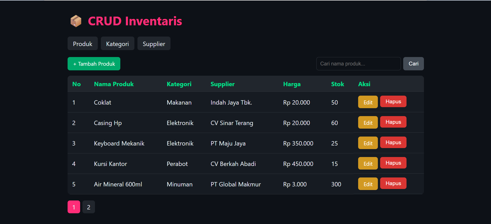
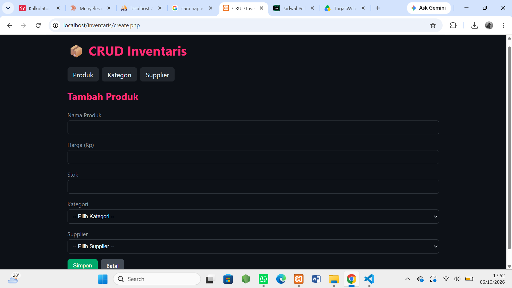
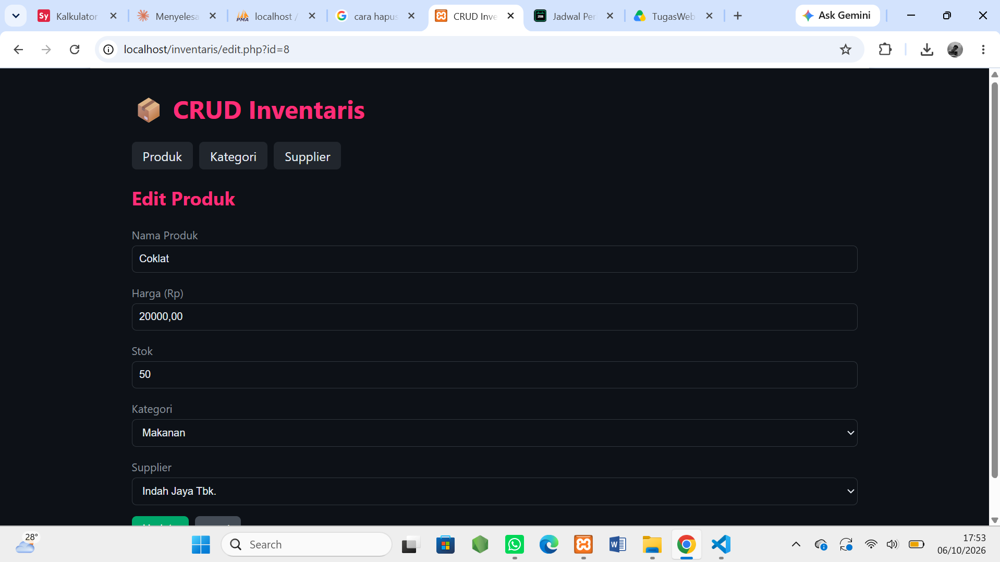
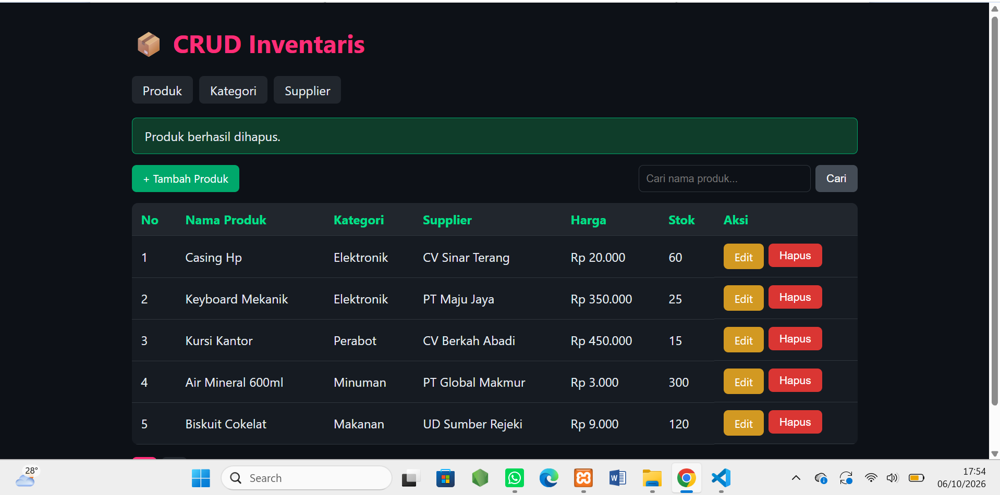
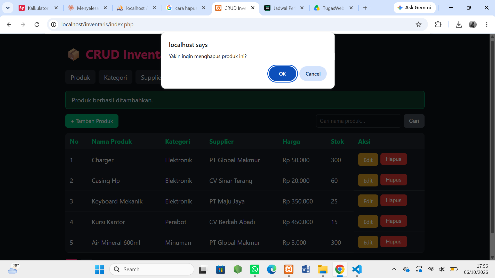
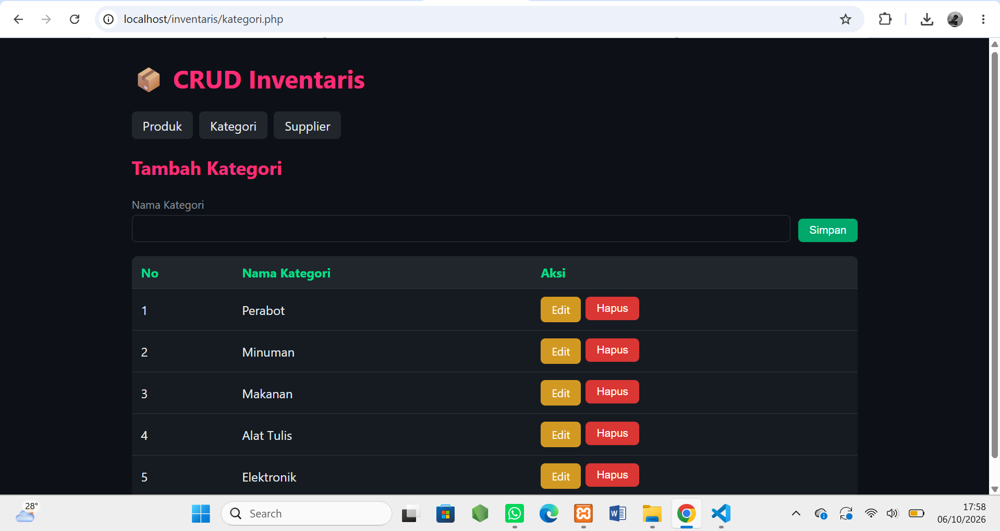
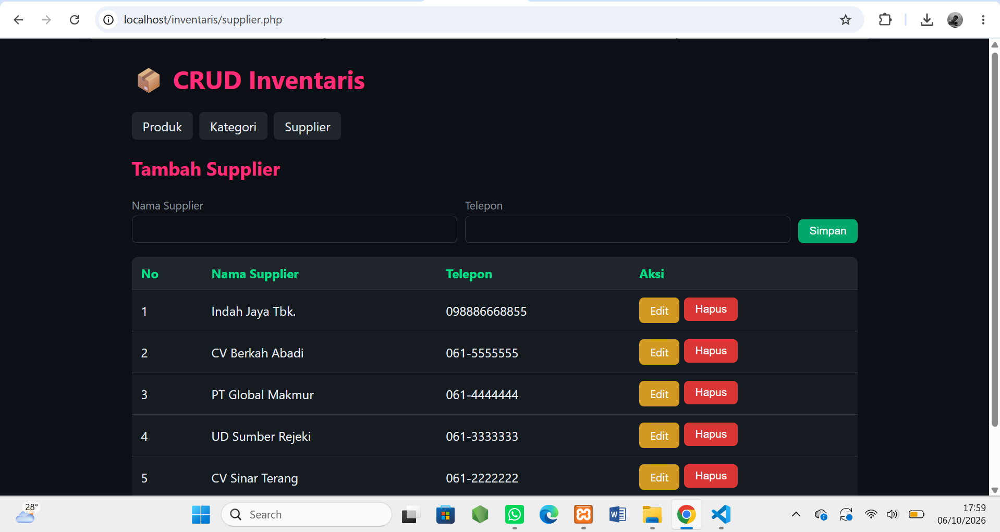

# CRUD Inventaris — Tugas Rutin 8

## Langkah Instalasi

### 1. Siapkan server lokal
Install **XAMPP**, lalu jalankan **Apache** dan **MySQL**.

### 2. Letakkan project
Salin folder `inventaris` ke `C:\xampp\htdocs\`.

### 3. Import database
1. Buka `http://localhost/phpmyadmin`.
2. Klik tab **Import**.
3. Klik **Choose File**, pilih `database.sql` dari folder project.
4. Klik **Import** di bagian bawah.
5. Database `inventaris_db` akan muncul di sidebar kiri, berisi tabel `kategori`, `supplier`, dan `produk` beserta data awal.

> Alternatif lewat terminal:
> `mysql -u root -p < database.sql`

### 4. Atur koneksi (jika perlu)
Buka `includes/config.php`, sesuaikan `DB_USER` dan `DB_PASS` jika MySQL kamu memakai password.

### 5. Jalankan aplikasi
Buka `http://localhost/inventaris/` di browser.

## Struktur Database

| Tabel | Kolom utama |
| `kategori` | id_kategori (PK), nama_kategori |
| `supplier` | id_supplier (PK), nama_supplier, telepon |
| `produk` | id_produk (PK), nama_produk, harga, stok, id_kategori (FK), id_supplier (FK) |

## Screenshot Aplikasi

### Daftar Produk

### Tambah Produk

### Edit Produk (form terisi data lama)

### Konfirmasi Hapus

### Flash Message

### Kelola Kategori

### Kelola Supplier

